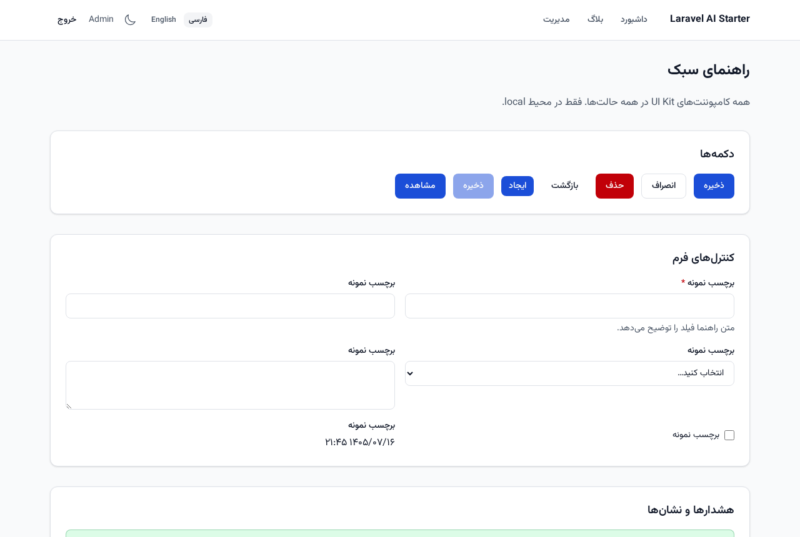
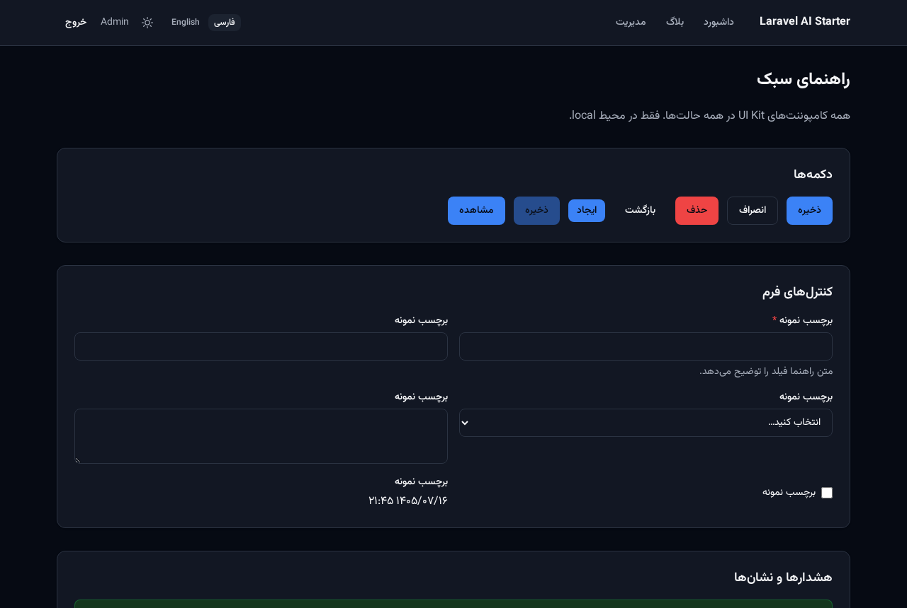
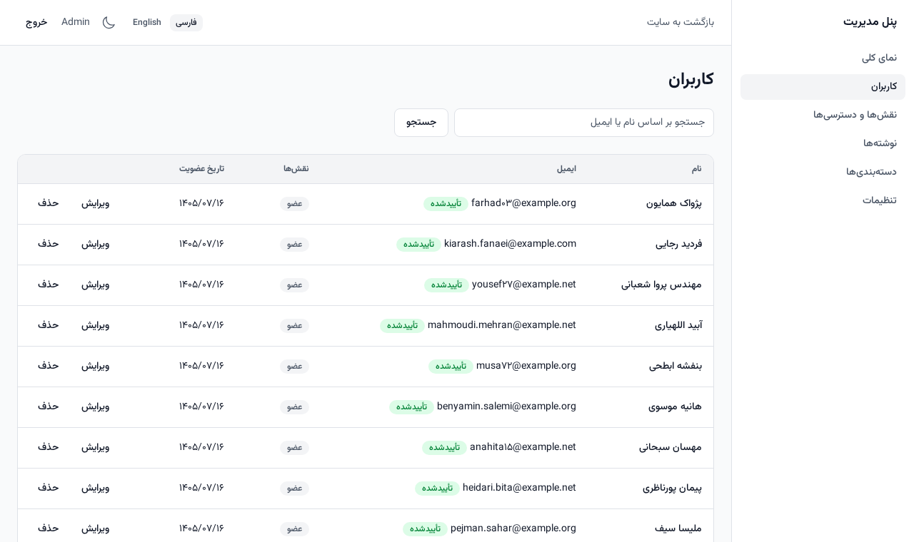
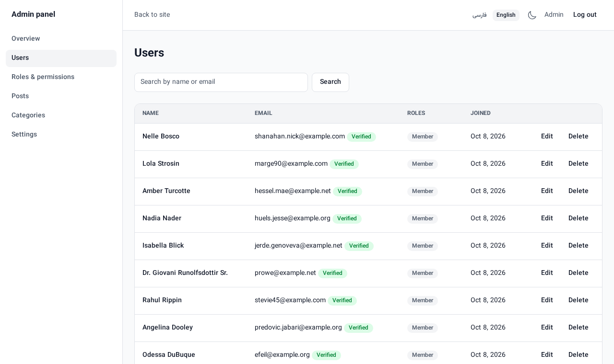
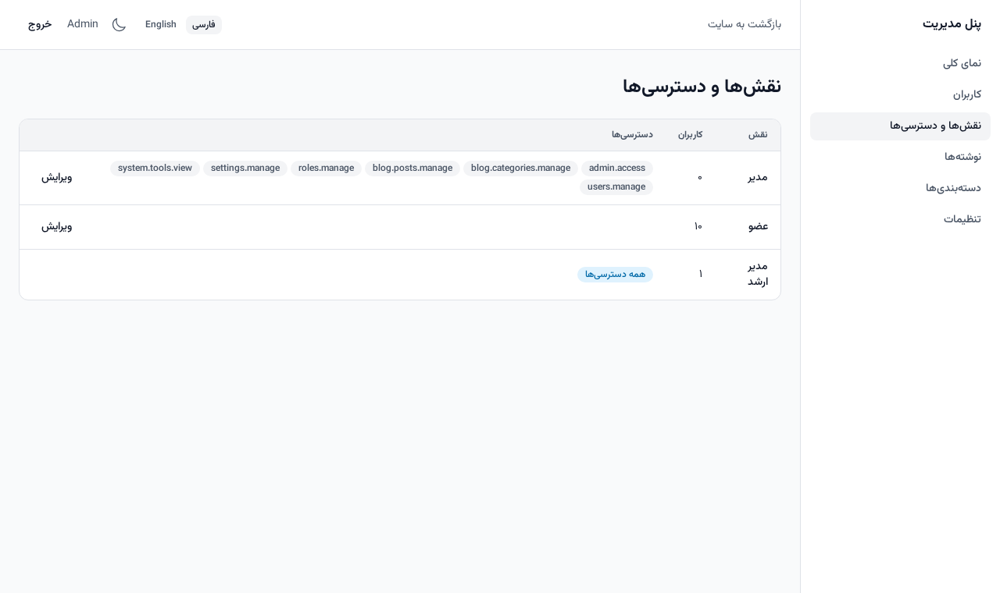
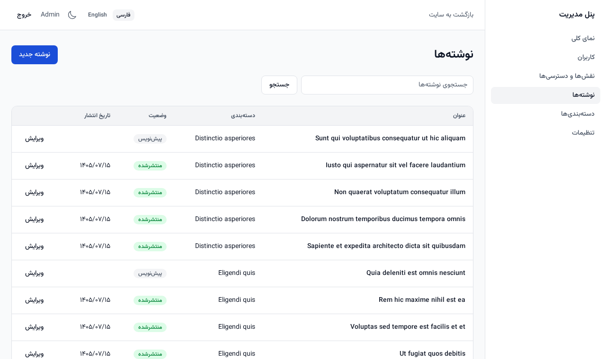
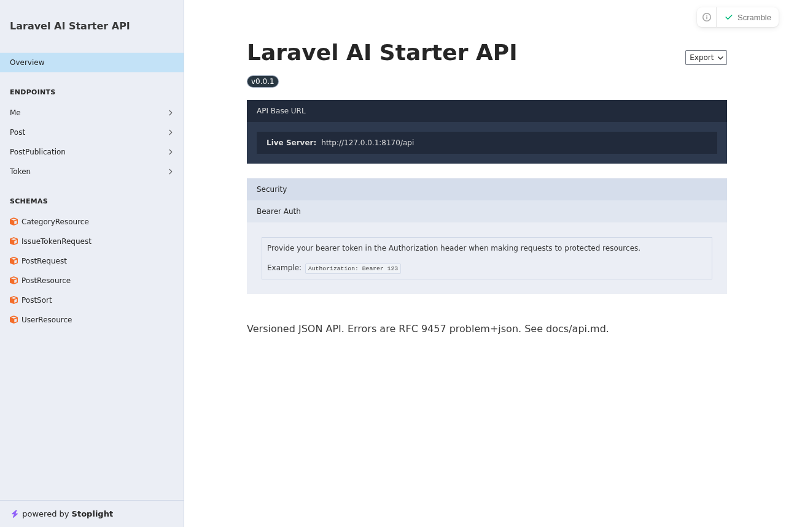
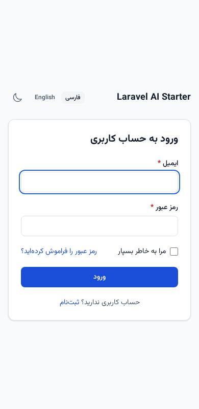
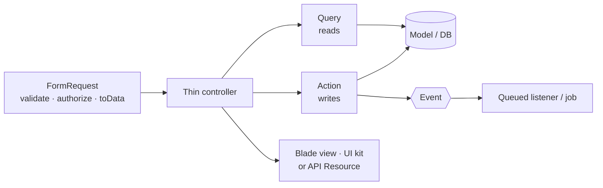
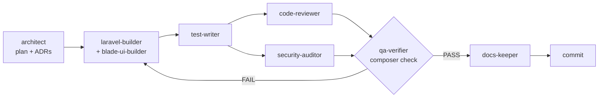

<div align="center">

# Laravel AI-First Starter Kit

**A modular Laravel 13 foundation where the rules are enforced by tooling — so humans *and* AI coding agents ship consistent, reviewable code.**

[](https://github.com/mohammadrasoulasghari/laravel-ai-sdk/actions/workflows/ci.yml)
[](LICENSE)


[Quick start](#quick-start) · [Why](#why-this-exists) · [What's inside](#whats-inside) · [AI agents](#built-for-ai-agents) · [Docs](#documentation) · [فارسی](README.fa.md)

 

</div>

> **Not to be confused with** Laravel's official AI SDK (`laravel/ai`), which is a *library for calling AI models from your app*.
> This is a *starter kit for structuring a whole Laravel application* so that **AI coding agents** (Claude Code, Cursor, Copilot, Codex…) can extend it without drifting from your architecture. The two work well together.

## Why this exists

AI agents write code fast — and quietly invent a new structure every time. Prose guidelines don't stop it; a long `CLAUDE.md` is ignored the moment it's inconvenient.

This kit takes the opposite approach: **every rule has an enforcer.** If a rule can't be checked by a test, a static-analysis rule, a formatter or a hook, it doesn't go in the "golden rules".

| Rule | Enforced by |
|---|---|
| Business logic never lives in controllers, models or views | Custom PHPStan rule + Pest architecture tests |
| Modules can't reach into each other's internals | Architecture tests (`ModuleBoundariesTest`) |
| `final`, `strict_types`, full types everywhere | Pint, PHPStan **level max**, 100% type coverage |
| No hard-coded UI text, RTL-safe CSS only | Blade arch tests (+ translation parity test) |
| Nobody edits `.env`, `vendor/` or committed migrations | Claude Code `PreToolUse` hook |
| An agent can't say "done" while the architecture is broken | Claude Code `Stop` hook (arch tests + PHPStan) |
| Conventional commits, formatted code | CaptainHook git hooks + CI |

Everything is wired behind one command — **`composer check`** — that CI also runs.

## Quick start

```bash
git clone https://github.com/mohammadrasoulasghari/laravel-ai-sdk.git my-app
cd my-app
make setup          # Docker (Sail): .env, deps, key, MySQL + Redis + Mailpit, migrate + seed, assets
```

Open **http://localhost** and sign in with **`admin@example.com` / `password`** (local seed only).

<details>
<summary><b>No Docker?</b> Run it with SQLite</summary>

Requires PHP 8.3+, Composer and Node 22.

```bash
cp .env.example .env
# In .env: DB_CONNECTION=sqlite (remove the other DB_* lines),
#          SESSION_DRIVER=file, CACHE_STORE=file, QUEUE_CONNECTION=sync, MAIL_MAILER=log
touch database/database.sqlite
composer setup                    # install, key, migrate + seed, npm install + build
php artisan serve & npm run dev
```
</details>

Make it *your* project in one command:

```bash
php artisan starter:init --name="Acme Shop" --package=acme/shop --url=https://shop.test --remove-example --fresh-git
```

It renames `composer.json`/`package.json`, sets `APP_NAME`/`APP_URL`, resets the changelog and git history, and (optionally) deletes the example Blog module. Run it without flags for interactive prompts, or add `--dry-run` to preview.

## What's inside

- 🧱 **Modular monolith** — one folder per business domain in `app/Modules/<Name>` (Actions · DTOs · Queries · Policies · Events · Models · views · lang · routes · migrations). A `ModuleServiceProvider` wires everything by convention.
- 🧭 **Clear write/read paths** — `FormRequest → thin controller → Action (writes) / Query object (reads) → Blade view or API Resource`. No repositories, no magic ([ADR-0005](docs/adr/0005-no-repository-pattern.md)).
- 👤 **Ready-made modules** — Auth (login, register, reset, email verification, API tokens), Users, Roles & permissions (spatie), Settings, Admin panel, and **Blog** as a complete reference module (web + API + policies + events + queued notifications + tests).
- 🎨 **UI kit & i18n** — ~20 `<x-ui.*>` Blade components, Tailwind CSS 4 design tokens, dark mode, **Persian (RTL) and English (LTR)** out of the box, Jalali dates, a built-in style guide at `/_styleguide`, accessible error pages.
- 🔌 **API** — versioned `/api/v1`, Sanctum tokens, RFC 9457 `problem+json` errors, a documented pagination/filter/sort contract, OpenAPI docs generated at `/docs/api` (Scramble).
- 🔒 **Security by default** — CSP with nonces, security headers, CORS allow-list, rate limits on credential endpoints, secure cookies, signed URLs, mass-assignment protection, audited final review.
- 📈 **Observability** — JSON logs with a correlation id on every request and queued job, `/up` + `/health/ready`, Horizon, Pulse, Telescope (local only), error-tracker hook.
- ⚙️ **Generators** — `make:module`, `make:action`, `make:dto`, `make:query`, `make:value-object`, `make:ui-component` produce code that passes `composer check` **without edits**.
- 🤖 **AI-first layer** — `CLAUDE.md` / `AGENTS.md`, 9 subagents, 11 skills, 6 slash commands, enforcement hooks, Laravel Boost MCP.

<details>
<summary><b>More screenshots</b></summary>
<br>

| Users (Persian, RTL) | Users (English, LTR) |
|---|---|
|  |  |

| Roles & permissions | Blog (reference module) |
|---|---|
|  |  |

| Generated OpenAPI docs | Mobile login |
|---|---|
|  |  |

</details>

## Architecture at a glance



```
app/Modules/Blog/   Actions/ Data/ Enums/ Events/ Exceptions/ Http/ Models/ Policies/ Queries/ …
app/Shared/         ModuleServiceProvider, DomainException, problem details, middleware, navigation, localization
```

Modules talk to each other only through `Contracts`, `Data`, `Enums` and `Events` — never through each other's internals (enforced). Read more in [docs/architecture.md](docs/architecture.md) and the [18 ADRs](docs/adr).

## Built for AI agents

[`CLAUDE.md`](CLAUDE.md) is the single source of truth (other tools read [`AGENTS.md`](AGENTS.md), which points to it). In Claude Code, build a feature end-to-end with:

```text
/feature Add a "Contact us" form that emails support, rate-limited, with an admin inbox
```



**Does it actually work?** Yes — a fresh agent that had read only `CLAUDE.md` built a complete Contact module (public form, rate limiting, queued mail, admin inbox, fa/en, 47 tests) through `/feature`, `composer check` green. Its 13 friction points were fed back into the skills and generators. The same kit was then used to build a full production-style platform with several agents working in parallel git worktrees.

| Agent | Role | | Skill | For |
|---|---|---|---|---|
| researcher | Verifies versions & APIs before installing | | new-module / new-action | Modules, write use cases |
| architect | Plans features, writes ADRs | | migration-model | Schema, models, factories |
| laravel-builder | Back-end from the plan | | web-crud / api-endpoint | Screens and `/api/v1` endpoints |
| blade-ui-builder | Views, RTL/LTR, dark mode | | blade-component | UI kit components |
| test-writer | Pest tests (writes only `tests/`) | | events-jobs | Idempotent queued work |
| code-reviewer · security-auditor | Read-only reviews | | i18n-rtl · writing-tests | Translations, tests |
| qa-verifier · docs-keeper | Run gates, keep docs true | | write-adr · fix-failing-check | Decisions, fixing red gates honestly |

Works with any agent that reads `AGENTS.md`; the Claude Code specifics (subagents, skills, hooks) live in `.claude/`.

## Quality gates

| Gate | Tool | Where it runs |
|---|---|---|
| Style | Pint (strict) · Prettier (Blade/JS/CSS) | `composer lint`, pre-commit, Claude hook, CI |
| Refactoring | Rector (PHP 8.3 + Laravel 13 sets) | `composer lint`, CI |
| Static analysis | PHPStan/Larastan **level max**, no baseline | `composer analyse`, pre-commit, Claude stop hook, CI |
| Architecture | Pest arch tests | `composer test`, Claude stop hook, CI |
| Tests | Pest 4 (SQLite locally, MySQL in CI) | `composer test`, CI (≥ 80% coverage) |
| Type coverage | 100% | `composer test:types`, CI |
| Mutation | Pest mutation (≥ 80%) | CI on pull requests |
| Dependencies | `composer audit`, `npm audit` | CI |

## Commands

| Command | What it does |
|---|---|
| `composer check` | Everything CI runs — must be green before "done" |
| `composer fix` | Rector → Pint → Prettier |
| `composer test` · `test:types` · `test:coverage` · `test:mutate` | Test suites and coverage gates |
| `make setup` · `up` · `down` · `fresh` · `check` · `shell` | Docker (Sail) wrappers |
| `php artisan make:module Contact` | Module skeleton, provider registered |
| `php artisan make:action Contact SendMessage` | Action + DTO + feature test (`--no-data` for model-only actions) |
| `php artisan make:dto` · `make:query` · `make:value-object` · `make:ui-component` | More generators |
| `php artisan permissions:sync` | Create roles and every module's permissions (idempotent) |

## Stack

| | |
|---|---|
| Runtime | PHP 8.3+ · Laravel 13 · MySQL 8.4 (PostgreSQL works) · Redis · Horizon |
| Front-end | Blade · Alpine.js · Tailwind CSS 4 · Vite 8 |
| Auth & access | Sanctum · spatie/laravel-permission · Policies/Gates |
| Quality | Pest 4 · Larastan · Pint · Rector · Prettier · CaptainHook |
| Ops | Sail · Pulse · Telescope (local) · Pennant (feature flags) · Scramble (OpenAPI) |
| AI tooling | Laravel Boost (MCP) · Claude Code agents/skills/hooks |

> The kit targets **PHP 8.3** on purpose (Pest 5 needs 8.4 — see [ADR-0003](docs/adr/0003-pest-4-until-php-84.md)). Sail's runtime image is PHP 8.4; CI tests both.

## How it compares

| | This kit | Laravel starter kits (Breeze / Jetstream) | Filament | `nwidart/laravel-modules` |
|---|---|---|---|---|
| Goal | Enforce architecture for humans **and agents** | Auth scaffolding | Admin panel framework | Module packaging |
| Module boundaries enforced | ✅ arch tests | ❌ | ❌ | ❌ |
| Agent skills, hooks, subagents | ✅ | ❌ | ❌ | ❌ |
| Persian UI + Jalali dates built in | ✅ | ❌ | ❌ | ❌ |
| Opinionated about code style/layers | very | little | medium | little |
| Admin UI | Blade, simple, yours to extend | n/a | full-featured | n/a |

It is deliberately **opinionated and Blade-only** (no Livewire/Inertia). If you want a full admin builder, use Filament inside a module; if you want maximum freedom, use Laravel's stock skeleton.

## Documentation

| | |
|---|---|
| [docs/README.md](docs/README.md) | Index |
| [Architecture](docs/architecture.md) · [Conventions](docs/conventions.md) | How the code is organised and the rules (with good/bad examples) |
| [Workflows](docs/workflows) | Add a module / endpoint / page / job / test |
| [API contract](docs/api.md) · [Caching](docs/caching.md) · [Observability](docs/observability.md) | Reference |
| [Add-ons](docs/add-ons) | Multi-tenancy, payments, SMS, 2FA, Sentry, uploads, search — documented, not forced on the core |
| [ADRs](docs/adr) | Every non-obvious decision and why |
| [Build report (Persian)](docs/FINAL_REPORT.md) | How the kit was built and audited |

## Roadmap

- [ ] Pest 5 / PHP 8.4 baseline once the ecosystem moves
- [ ] Playwright browser tests for the critical paths
- [ ] More add-on recipes (Stripe/Zarinpal payments, Scout search) as runnable modules
- [ ] `composer create-project` support via Packagist

Ideas and votes welcome in [Discussions / Issues](https://github.com/mohammadrasoulasghari/laravel-ai-sdk/issues).

## Contributing

Contributions are very welcome — start with [CONTRIBUTING.md](CONTRIBUTING.md). The one rule: `composer check` must pass, and a change to a convention needs an [ADR](docs/adr/template.md). Please follow the [Code of Conduct](CODE_OF_CONDUCT.md). For vulnerabilities see [SECURITY.md](SECURITY.md) — don't open a public issue.

## Credits & license

Built on the shoulders of [Laravel](https://laravel.com), [Pest](https://pestphp.com), [Larastan](https://github.com/larastan/larastan), [Laravel Pint](https://laravel.com/docs/pint), [Rector](https://getrector.com), [spatie/laravel-permission](https://github.com/spatie/laravel-permission), [Scramble](https://scramble.dedoc.co), [Laravel Boost](https://laravel.com/docs/boost), [Tailwind CSS](https://tailwindcss.com), [Alpine.js](https://alpinejs.dev) and [Vazirmatn](https://github.com/rastikerdar/vazirmatn).

Released under the [MIT License](LICENSE). If this kit saves you time, a ⭐ helps others find it.
