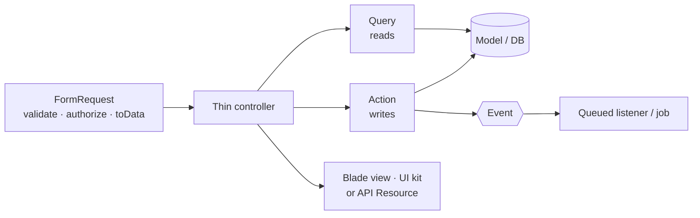
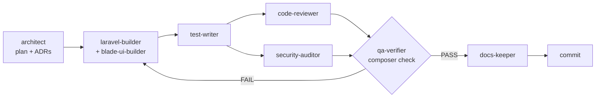

# Laravel AI-First Starter Kit

A modular **Laravel 13** (PHP ≥ 8.3) starter kit built so that AI coding agents — and humans — produce
consistent, reviewable code. Conventions are written down once (`CLAUDE.md`, `docs/`), turned into
step-by-step skills for agents, and **enforced** by static analysis, architecture tests, git hooks,
Claude Code hooks and CI.

UI: Blade + Alpine.js + Tailwind CSS 4, Persian (RTL, default) and English (LTR). API: versioned JSON
with Sanctum and RFC 9457 problem details. Infra: MySQL 8.4, Redis, Horizon, Docker via Sail.

## Features

- **Modular monolith** — `app/Modules/<Name>` per domain, boundaries enforced by arch tests; shared kernel in `app/Shared`.
- **Ready-made modules** — Auth (login, register, password reset, email verification, API tokens), Users, Roles & permissions (spatie/laravel-permission), Settings, Admin panel, and **Blog** as the reference module (web + API + policies + events + tests).
- **Strict code** — `strict_types`, `final` classes, Actions/Query objects/DTOs (no repositories), PHPStan level max with a custom rule, 100% type coverage, Pint, Rector.
- **UI kit** — 20 `<x-ui.*>` components, app/guest/admin layouts, dark mode, design tokens, logical (RTL-safe) utilities, Vazirmatn font, Jalali dates, style guide at `/_styleguide`, error pages.
- **API** — `/api/v1`, Sanctum tokens, problem+json errors, filtering/sorting/pagination contract, OpenAPI docs at `/docs/api` (Scramble).
- **Security** — CSP with nonces, security headers (HSTS toggle), CORS, rate limits, encrypted sessions.
- **Observability** — JSON logs with correlation id, `/up` and `/health/ready`, Pulse, Horizon, Telescope (local), error-tracker hook.
- **Feature flags** — Laravel Pennant.
- **Generators** — `make:module`, `make:action`, `make:dto`, `make:query`, `make:value-object`, `make:ui-component`, and `starter:init` to turn the kit into your project.
- **AI-first layer** — `CLAUDE.md`, `AGENTS.md`, 9 Claude Code subagents, 11 skills, 6 slash commands, enforcement hooks, Laravel Boost MCP.

## Quick start (Docker)

```bash
git clone <repository-url> my-app
cd my-app
make setup        # .env, composer install, Sail up, key, migrate + seed, npm build
```

Open **http://localhost** and log in with **`admin@example.com` / `password`** (super-admin).
Mailpit: http://localhost:8025.

### Without Docker (SQLite)

Requires PHP 8.3+, Composer and Node 22.

```bash
cp .env.example .env
# In .env: DB_CONNECTION=sqlite and remove the other DB_* lines;
#          SESSION_DRIVER=file, CACHE_STORE=file, QUEUE_CONNECTION=sync (no Redis), MAIL_MAILER=log
touch database/database.sqlite
composer setup    # install, key, migrate + seed, npm install + build
php artisan serve & npm run dev   # or `composer dev` (server, Horizon, logs, Vite) if Redis runs
```

## Architecture at a glance



```
app/Modules/Blog/   Actions/ Data/ Enums/ Events/ Exceptions/ Http/ Models/ Policies/ Queries/ …
app/Shared/         ModuleServiceProvider, DomainException, problem details, middleware, navigation, localization
```

Details: [docs/architecture.md](docs/architecture.md) · rules: [docs/conventions.md](docs/conventions.md).

## Commands

| Command | What it does |
|---|---|
| `composer check` | Everything CI runs: lint + analyse + test + type coverage. Must be green. |
| `composer fix` | Rector → Pint → Prettier |
| `composer lint` | Pint, Rector (dry run), Prettier — no changes |
| `composer analyse` | PHPStan / Larastan level max |
| `composer test` | Pest (unit, feature, arch) |
| `composer test:types` / `test:coverage` / `test:mutate` | 100% type coverage / ≥ 80% line coverage / mutation testing |
| `composer setup` / `composer dev` | Non-Docker install / dev processes (server, Horizon, Pail logs, Vite) |
| `make setup \| up \| down \| fresh \| test \| check \| fix \| shell` | Docker (Sail) wrappers; `make` lists them |
| `npm run dev \| build \| format` | Vite and Prettier |
| `php artisan make:module Contact` | Module skeleton, provider registered |
| `php artisan make:action Contact SendMessage` | Action + DTO + feature test |
| `php artisan make:dto \| make:query \| make:value-object <Module> <Name>` | DTO / Query object / Value Object (+ unit test) |
| `php artisan make:ui-component tabs` | `<x-ui.tabs>` component |
| `php artisan permissions:sync` | Create roles and all module permissions (idempotent) |
| `php artisan starter:init` | Rename the kit into a new project |

## Create a new project from this kit

```bash
git clone <repository-url> acme-shop && cd acme-shop
php artisan starter:init --name="Acme Shop" --package=acme/shop --url=https://shop.test --remove-example --fresh-git
make setup
```

`starter:init` renames `composer.json`/`package.json`, sets `APP_NAME`/`APP_URL`, resets `CHANGELOG.md`
and the README title, generates an app key, optionally deletes the Blog example and restarts git
history. Run it without options for interactive prompts, or add `--dry-run` to preview. See ADR-0017.

## Working with AI agents

[`CLAUDE.md`](CLAUDE.md) is the single source of truth for agents (other tools read
[`AGENTS.md`](AGENTS.md), which points to it). Generic Laravel guidance from Laravel Boost lives in
[`docs/ai/laravel-boost.md`](docs/ai/laravel-boost.md); `CLAUDE.md` wins on conflicts (ADR-0016).

In Claude Code, build a feature with **`/feature <description>`**:



Other commands: `/new-module <Name>`, `/review`, `/check`, `/adr <topic>`, `/audit`.

| Agent (`.claude/agents/`) | Role |
|---|---|
| researcher | Verifies package versions and APIs before installing (read-only) |
| architect | Plans features, writes ADRs (writes only `docs/`) |
| laravel-builder | Back-end implementation from the plan |
| blade-ui-builder | Views, UI kit, RTL/LTR, dark mode |
| test-writer | Pest tests (writes only `tests/`) |
| code-reviewer | Conventions and architecture review (read-only) |
| security-auditor | OWASP-focused audit (read-only) |
| qa-verifier | Runs every gate independently and reports PASS/FAIL |
| docs-keeper | Keeps docs and CHANGELOG accurate |

| Skill (`.claude/skills/`) | Use for |
|---|---|
| new-module, new-action, migration-model | Modules, write use cases, schema + models |
| web-crud, api-endpoint, blade-component | Screens, `/api/v1` endpoints, UI kit components |
| events-jobs, i18n-rtl, writing-tests | Side effects/queues, translations/RTL, tests |
| write-adr, fix-failing-check | Decisions, fixing red gates without weakening rules |

**Hooks** (`.claude/settings.json`, ADR-0018): Pint after every PHP edit; edits to `.env`, `vendor/`,
`node_modules/` and committed migrations are blocked; on stop, arch tests + PHPStan on changed files must pass.

**Laravel Boost MCP** (`.mcp.json`): `search-docs` for version-correct docs, `database-schema`,
`list-routes`, `read-log-entries`.

Human-oriented recipes: [docs/workflows/](docs/workflows).

## Quality gates

| Gate | Tool | Runs in |
|---|---|---|
| Code style | Pint (strict), Prettier (Blade/JS/CSS) | `composer lint`, pre-commit (Pint), Claude hook, CI |
| Refactoring rules | Rector (PHP 8.3 + Laravel 13 sets) | `composer lint`, CI |
| Static analysis | PHPStan/Larastan level max + custom rule (no Eloquent in controllers), no baseline | `composer analyse`, pre-commit, Claude stop hook, CI |
| Architecture | Pest arch tests (`tests/Arch`) | `composer test`, Claude stop hook, CI |
| Tests | Pest unit + feature (MySQL in CI) | `composer test`, CI with ≥ 80% coverage |
| Type coverage | Pest type coverage 100% | `composer test:types`, CI |
| Mutation | Pest mutation (≥ 80%) | CI on pull requests |
| Dependencies | `composer audit`, `npm audit` | CI |
| Commit messages | Conventional Commits (CaptainHook) | `commit-msg` hook |

## Project layout

```
app/Console/        generators, starter:init, StubRenderer
app/Modules/        Admin, Auth, Blog (reference), Roles, Settings, Users
app/Shared/         cross-cutting kernel
resources/          css (tokens), js (Alpine), views (layouts, UI kit, error pages)
lang/{en,fa}/       shared translations (modules have their own lang/)
stubs/starter/      generator templates
tests/              Arch/, Feature/, Unit/, Support/helpers.php
tools/phpstan/      custom PHPStan rules
docs/               architecture, conventions, ADRs, workflows, add-ons
.claude/            agents, skills, commands, hooks, settings
```

## Documentation

Start at [docs/README.md](docs/README.md). Key pages: [architecture](docs/architecture.md),
[conventions](docs/conventions.md), [API](docs/api.md), [ADRs](docs/adr), [workflows](docs/workflows),
[add-ons](docs/add-ons). Contributing: [CONTRIBUTING.md](CONTRIBUTING.md).

## Versioning

[Semantic Versioning](https://semver.org). Changes are recorded in [CHANGELOG.md](CHANGELOG.md)
([Keep a Changelog](https://keepachangelog.com)); every PR adds a line under `[Unreleased]`.

## License

[MIT](LICENSE).
