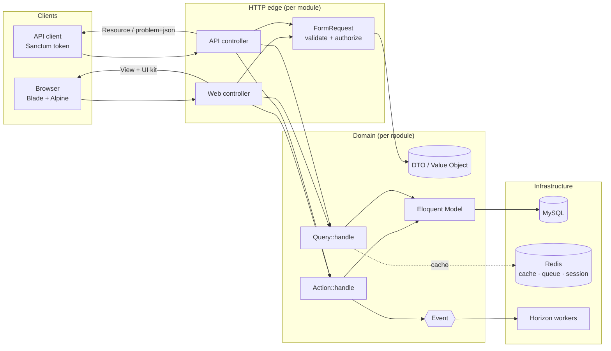
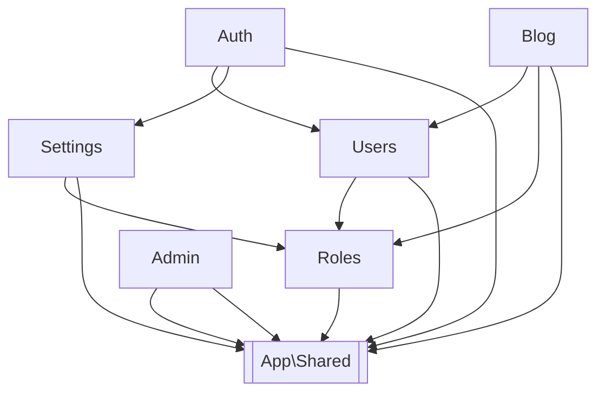

# Architecture

A modular monolith on Laravel 13. Each business domain is a **module** with its own HTTP layer,
actions, data, models, views, translations, routes and migrations. Modules talk to each other only
through **contracts** and **events**. Cross-cutting infrastructure lives in `app/Shared`.

## Big picture



## Request lifecycle

1. Global middleware: `AssignCorrelationId` (X-Request-Id → Laravel Context → every log line and queued job), `SetLocale` (Accept-Language), security headers.
2. Group middleware: `web` (session, CSRF, `SetLocale` from session) or `api` (`throttle:api`).
3. Route → **FormRequest** validates and authorizes, then `->toData()` builds an immutable DTO.
4. Controller calls **one** Action (writes) or Query (reads).
5. Action enforces business rules, throws a `DomainException` subclass on violation, persists, dispatches events.
6. Response: Blade view built from the UI kit, or API Resource.
7. Errors: `bootstrap/app.php` renders API errors as RFC 9457 problem+json (`ProblemDetailsFactory`) and web domain errors as a redirect back with a flash message. Blade error pages live in `resources/views/errors`.

## Module anatomy

```
app/Modules/Blog/
├── Actions/          CreatePost, UpdatePost, PublishPost, DeletePost …
├── Contracts/        (public) interfaces other modules may depend on
├── Data/             (public) PostData, PostFiltersData …
├── Database/
│   ├── Factories/    PostFactory, CategoryFactory
│   ├── Migrations/
│   └── Seeders/
├── Enums/            (public) PostStatus, BlogPermission
├── Events/           (public) PostPublished
├── Exceptions/       PostAlreadyPublishedException …
├── Http/
│   ├── Controllers/  PostController, Admin\PostController, Api\PostController
│   ├── Requests/
│   └── Resources/
├── Listeners/
├── Jobs/
├── Models/           Post, Category
├── Policies/
├── Providers/        BlogServiceProvider (routes, views, lang, migrations, policies, events, nav, permissions)
├── Queries/          PublishedPostsQuery, AdminPostsQuery
├── ValueObjects/     Slug
├── lang/{en,fa}/
├── resources/views/
└── routes/{web,api}.php
```

`App\Shared\Providers\ModuleServiceProvider` wires all of the conventional folders automatically.
A module provider only declares `$bindings`, `$policies`, `$listen` and registers navigation items
and permissions in `bootModule()`.

## Module dependency graph (built-in modules)



Arrows mean "uses the public API of". Only `Contracts`, `Data`, `Enums`, `Events` (+ the `User` model) cross an arrow.

## Shared layer (`app/Shared`)

| Piece | Purpose |
|---|---|
| `Providers/ModuleServiceProvider` | Base class for module providers |
| `Exceptions/DomainException` | Base for business-rule violations (status, error code, translation key) |
| `Http/Problems/*` | RFC 9457 problem+json responses |
| `Http/Middleware/*` | Correlation id, locale, security headers, local-only |
| `Http/Flash` | Typed flash messages |
| `Navigation/*` | Registry modules add menu items to; layouts render visible ones |
| `Auth/PermissionRegistry`, `Auth/SystemAbility` | Modules declare permissions; `permissions:sync` persists them |
| `Localization/*` | Supported locales, direction, calendar |
| `Support/DateFormatter`, `View/Components/Date` | Jalali/Gregorian presentation |

## Front-end

Blade + Alpine.js + Tailwind CSS 4 via Vite. Design tokens in `resources/css/tokens.css`,
dark mode via a `.dark` class, RTL/LTR from `config/locales.php`, UI kit in
`resources/views/components/ui`, layouts in `resources/views/components/layouts`. See ADR-0009.

## Infrastructure

| Concern | Choice | Where |
|---|---|---|
| Queue | Redis + Horizon | `config/horizon.php`, `compose.yaml` service `horizon` |
| Scheduler | `schedule:work` container | `routes/console.php` |
| Cache | Redis, strategy in [`caching.md`](caching.md) | |
| Feature flags | Laravel Pennant (database driver) | per module, e.g. `app/Modules/Blog/Features/ReadingTime.php` |
| Observability | JSON logs + correlation id, Pulse, Telescope (local), `/up` + `/health/ready` | [`observability.md`](observability.md) |
| API docs | Scramble → `/docs/api` | [`api.md`](api.md) |
| Files | `Storage` with configurable `UPLOADS_DISK` (local/public/s3) | `config/filesystems.php` |

## Decisions

All non-obvious decisions are ADRs in [`docs/adr`](adr). Start with ADR-0004 (modules), ADR-0005 (no repositories), ADR-0006 (boundaries).
